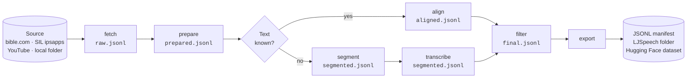

<p align="center">
  <picture>
    <source media="(prefers-color-scheme: dark)" srcset="assets/brand/svg/fasospeechcorpora-horizontal-reversed.svg">
    
  </picture>
</p>

<p align="center">
  Speech datasets for the languages of Burkina Faso, and any other.<br>
  <a href="https://github.com/anyantudre/FasoSpeechCorpora/actions/workflows/tests.yml"></a>
  
  <a href="LICENSE"></a>
</p>

FasoSpeechCorpora turns long recordings into short audio clips paired with their text, ready to train speech recognition (ASR) or text-to-speech (TTS) models.

It extends MooreSpeechCorpora, the original work on Mooré that produced the [Mooré speech datasets](#datasets). The same pipeline now covers Dioula, Fulfuldé, Gourmantchéma and any other language: one config file is enough to add one.

- It fetches audio, and the text when there is one, from audio Bibles on bible.com, SIL audio books, YouTube or your own folder.
- It cuts each recording into sentences. When the text is known, forced alignment finds where each sentence is spoken. When it isn't, FasoSpeechCorpora splits the audio at pauses and a speech model transcribes the clips.
- It exports the clips as a Hugging Face dataset, an LJSpeech folder or a JSONL manifest.

It runs on Linux, macOS, Windows and Colab, on CPU or GPU.

## Quick start

```bash
git clone https://github.com/anyantudre/FasoSpeechCorpora
cd FasoSpeechCorpora
pip install -e ".[align,hub]"
fasospeech run recipes/mos-bible.yaml --limit 2
```

For a GPU, install the PyTorch build for your CUDA version first (see [pytorch.org](https://pytorch.org/get-started/locally/)).

This downloads the first two chapters of Genesis in Mooré, aligns each sentence with the audio and writes the clips to `data/mos-bible/`:

```text
data/mos-bible/
├── raw/             downloaded audio
├── wav/             the same audio, mono 16 kHz
├── clips/GEN_1/     one wav per sentence
└── final.jsonl      one line per clip
```

```json
{"id": "GEN_1_0002", "audio_filepath": "clips/GEN_1/GEN_1_0002.wav", "text": "Sɩngr wẽndẽ, Wẽnnaam naana yĩngr la tẽnga.", "duration": 3.923, "start": 9.626, "end": 13.549, "language": "mos", "source": "bible.com/3058", "source_id": "GEN_1", "score": 0.4788}
```

Check the result against a speech recognition model (character error rate on a sample of clips):

```bash
pip install "fasospeechcorpora[asr]"
fasospeech check recipes/mos-bible.yaml --sample 50
```

## How it works

A recipe lists the steps to run. Each step reads and writes a JSONL manifest, so you can rerun any step on its own, and FasoSpeechCorpora skips work that is already done.



| Step | What it does |
|---|---|
| `fetch` | Downloads audio (and text) from the source |
| `prepare` | Decodes to mono 16 kHz wav |
| `align` | Text known: finds where each sentence is spoken (MMS forced aligner) |
| `segment` | No text: cuts at pauses into 2 to 15 s clips |
| `transcribe` | No text: labels the clips with an ASR model |
| `filter` | Drops clips that are too short, too long, badly aligned, in another language, or with too little text for their length |
| `export` | Writes the Hugging Face dataset or LJSpeech folder, and can push to the Hub |

Run only some steps with `--steps align,filter`.

## Add your language

A language is a small YAML file. Copy one from [`src/fasospeechcorpora/languages/`](src/fasospeechcorpora/languages) and change it:

```yaml
code: dyu                 # ISO 639-3
name: Dioula
letters: "abcdeɛfghijklmnɲŋoɔprstuwyz"   # used to drop text in other languages
sentence_end: ".!?"
mms_code: dyu             # MMS speech model adapter, used by `fasospeech check`
```

Then point a recipe at it with `language: dyu`, or at your own file with `language: {file: my-language.yaml}`.

## Add your source

A recipe says where the audio comes from and how to process it:

```yaml
language: gux
source:
  type: bible_com         # bible_com, ipsapps, youtube or local
  version: 3056           # the number in the bible.com URL
  abbreviation: BGP
  start: GEN.1
filter:
  max_duration: 30
export:
  formats: [manifest, hf]
  repo_id: your-name/GourmantchemaSpeechCorpora   # omit to keep the dataset local
  private: true
  gated: manual           # people must request access before downloading
```

To build from your own recordings, use `type: local` and put a `.txt` file next to each audio file. A plain transcript is split into sentences and aligned. An Audacity label file (`start`, `end`, `text` on each line) is cut as it is, so hand-labelled clips need no alignment. Files without a `.txt` are cut at pauses and transcribed. New source types are a class with one `fetch` method; see [`sources/base.py`](src/fasospeechcorpora/sources/base.py).

## Languages and sources

| Language | Code | Recipe | Status |
|---|---|---|---|
| Mooré | mos | `mos-bible`, `mos-tales`, `mos-proverbs`, `mos-proverbs-v10`, `mos-youtube` | Datasets published |
| Dioula | dyu | `dyu-bible` | Tested on 2 chapters: CER 5.8% |
| Gourmantchéma | gux | `gux-bible` | Tested on 2 chapters: CER 3.6% |
| Fulfuldé (Maasina) | ffm | `ffm-bible` (New Testament) | Tested on 2 chapters: CER 6.4% |
| Fulfuldé (Western Niger) | fuh | `fuh-bible` (New Testament) | Tested on 2 chapters: CER 9.3% |

CER is the character error rate of the MMS speech recognizer (`facebook/mms-1b-all`) on 60 clips, against each clip's text, as reported by `fasospeech check`. It mixes recognizer errors with alignment errors, so treat it as an upper bound on alignment problems. Both Fulfuldé varieties use the MMS `ful` model, which fits Maasina better.

## Alignment backends

The default aligner is Meta's MMS model through torchaudio, with the Python `uroman` romanizer. It needs no Perl or fairseq and runs on every platform.

The original pipeline, fairseq's MMS `align_and_segment` script with the Perl `uroman`, is kept as `align: {backend: fairseq, fairseq_dir: ..., uroman_dir: ...}`. The published Mooré datasets were built with it. It only runs on Linux.

On Genesis 1 and 2 in Mooré, the two backends cut the same 115 sentences. Scored with the MMS recognizer, those clips have the same character error rate: 5.4% vs 5.3% on Genesis 1 and 6.8% for both on Genesis 2. The torchaudio clips are about 0.2 s shorter. The fairseq data also has one clip per chapter for the spoken title, which the narrator reads differently from the page; FasoSpeechCorpora leaves titles out by default.

## Datasets

Published so far, all in Mooré:

| Dataset | Content | Size |
|---|---|---|
| [moore-speech-bible](https://huggingface.co/datasets/anyantudre/moore-speech-bible) | Mooré Bible (bible.com and jw.org) | about 146 h |
| [moore-speech-contes](https://huggingface.co/datasets/anyantudre/moore-speech-contes) | Tales | 4.8 h |
| [moore-speech-proverbes](https://huggingface.co/datasets/anyantudre/moore-speech-proverbes) | Proverbs with French translations | 2.3 h Mooré |
| [moore-speech-devinettes](https://huggingface.co/datasets/anyantudre/moore-speech-devinettes) | Riddles | 1.4 h |
| [MooreSpeechCorpora](https://huggingface.co/datasets/anyantudre/MooreSpeechCorpora) | Tales, riddles and proverbs, denoised | 8.7 h |

The datasets are gated and for non-commercial research use.

Once the toolkit is mature, each language gets its own dataset on Hugging Face, named after the original one and published in gated mode: MooreSpeechCorpora, DioulaSpeechCorpora, GourmantchemaSpeechCorpora, FulfuldeSpeechCorpora, and so on.

## Use sources responsibly

FasoSpeechCorpora downloads what you point it at. Read each site's terms before you run a recipe, and get permission before you publish a dataset built from someone else's recordings.

- bible.com (YouVersion) allows personal use only and forbids automated access in its terms. Bible texts and recordings belong to their publishers.
- YouTube's terms forbid downloading without permission from the rights holder.
- The MMS aligner and speech models are licensed CC-BY-NC 4.0, so datasets aligned with them are best kept non-commercial.

FasoSpeechCorpora waits between requests: 1 s by default (`delay` in the recipe) and 5 to 10 s on YouTube.

## Credits

FasoSpeechCorpora is the continuation of MooreSpeechCorpora (this repository's earlier name) and absorbs three older repositories: [speech-dataset-generator](https://github.com/anyantudre/speech-dataset-generator), [moore-data-scraping-bible](https://github.com/anyantudre/moore-data-scraping-bible) and data-alignment-moore, which built the tales and proverbs datasets. They are archived and read-only; their commit history is part of this repository.

- The first bible.com scraper came from [cawoylel/nlp4all](https://github.com/cawoylel/nlp4all).
- Splitting at pauses started from [thorstenMueller/Audio-to-Voice-Dataset](https://github.com/thorstenMueller/Audio-to-Voice-Dataset).
- Alignment uses [MMS](https://github.com/facebookresearch/fairseq/tree/main/examples/mms) by Meta AI through [torchaudio](https://pytorch.org/audio), with [uroman](https://github.com/isi-nlp/uroman) by ISI.
- The YouTube recipe downloads with [yt-dlp](https://github.com/yt-dlp/yt-dlp) and labels clips with [moore-asr-eval-w2vbert](https://huggingface.co/anyantudre/moore-asr-eval-w2vbert). The Mooré and Dioula speech models from [GO AI Corp](https://huggingface.co/goaicorp) work as well.
- The denoised audio in MooreSpeechCorpora was made with [Resemble Enhance](https://github.com/resemble-ai/resemble-enhance); see [`tutorials/noise_reduce.ipynb`](tutorials/noise_reduce.ipynb).

## Citation

```bibtex
@misc{nyantudre2026fasospeechcorpora,
  author = {Nyantudre, Wendyellé A. Alban},
  title  = {FasoSpeechCorpora: speech datasets for the languages of Burkina Faso},
  year   = {2026},
  url    = {https://github.com/anyantudre/FasoSpeechCorpora}
}
```

Code under the [MIT licence](LICENSE).
