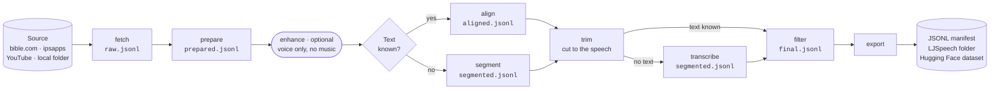

<p align="center">
  <picture>
    <source media="(prefers-color-scheme: dark)" srcset="assets/brand/svg/fasospeechcorpora-horizontal-reversed.svg">
    
  </picture>
</p>

<p align="center">
  Speech datasets for the languages of Burkina Faso, and any other.<br>
  <a href="https://github.com/anyantudre/FasoSpeechCorpora/actions/workflows/tests.yml"></a>
  
  <a href="LICENSE"></a>
</p>

FasoSpeechCorpora turns long recordings into short audio clips paired with their text, for training speech recognition (ASR) and text-to-speech (TTS) models. It grew out of MooreSpeechCorpora, the original Mooré work behind the [Mooré speech datasets](#datasets), and now covers Dioula, Fulfuldé, Gourmantchéma and any language with a config file.

It reads audio Bibles on bible.com, audio books on ipsapps.org, YouTube, Hugging Face datasets or your own folder. When the text is known, forced alignment cuts each sentence; when it isn't, the audio is cut at pauses and an ASR model writes the text. Clips are exported as a Hugging Face dataset, an LJSpeech folder or a JSONL manifest.

It runs on Linux, macOS, Windows and Colab, on CPU or GPU.

## Quick start

```bash
git clone https://github.com/anyantudre/FasoSpeechCorpora
cd FasoSpeechCorpora
pip install -e ".[align,hub]"
fasospeech run recipes/mos-bible.yaml --limit 2
```

For a GPU, install the PyTorch build for your CUDA version first ([pytorch.org](https://pytorch.org/get-started/locally/)).

This aligns the first two chapters of Genesis in Mooré and writes one clip per sentence to `data/mos-bible/`:

```text
data/mos-bible/
├── raw/             downloaded audio
├── wav/             mono 16 kHz
├── clips/GEN_1/     one wav per sentence
└── final.jsonl      one line per clip
```

```json
{"id": "GEN_1_0002", "audio_filepath": "clips/GEN_1/GEN_1_0002.wav", "text": "Sɩngr wẽndẽ, Wẽnnaam naana yĩngr la tẽnga.", "duration": 3.923, "start": 9.626, "end": 13.549, "language": "mos", "source": "bible.com/3058", "source_id": "GEN_1", "score": 0.4788}
```

To check a sample of clips against an ASR model:

```bash
pip install "fasospeechcorpora[asr]"
fasospeech check recipes/mos-bible.yaml --sample 50
```

## How it works

A recipe lists the steps to run. Each step reads and writes a JSONL manifest, so any step can be rerun alone, and finished work is skipped.



| Step | What it does | Extra |
|---|---|---|
| `fetch` | Downloads audio and text | `youtube` for YouTube |
| `prepare` | Converts to mono 16 kHz wav | |
| `enhance` | Removes background music from the recordings (optional) | `enhance` |
| `align` | Finds where each sentence is spoken (MMS) | `align` |
| `segment` | Cuts at pauses into 2 to 15 s clips | |
| `trim` | Cuts music and silence at clip edges; keeps a voice-only copy | `enhance` |
| `transcribe` | Labels clips that have no text | `asr` |
| `verify` | Scores each clip's text with one or more ASR models (CER) | `asr` |
| `detect_cs` | Tags French words in Mooré text (optional) | `codeswitch` |
| `filter` | Drops bad clips (length, CER, language, music); cleans text | |
| `speakers` | Groups clips by voice and guesses male or female | `speakers` |
| `export` | Writes the dataset and can push it to the Hub | `hub` |

Install an extra with `pip install ".[name]"`. Run only some steps with `--steps align,filter`. The recipes in [`recipes/`](recipes) show each step's options.

### TTS and ASR views

One run can write a clean view for TTS and a noisier one for ASR:

```yaml
filter:
  max_music_under_voice_db: -30          # final.jsonl: TTS, no music under the voice
  variants:
    asr: {max_music_under_voice_db: null}   # final_asr.jsonl: music bed kept
    fra: {languages: [fra]}                 # final_fra.jsonl: French lines
  negatives: {of: asr, max_share: 0.1}      # music-only clips with empty text
  tagged: {of: asr}                         # untrimmed, <MUSIC> on music edges
export:
  configs: [tts, asr, asr_negatives, asr_tagged, fra]
```

Tags (`<MUSIC> <NOISE> <LAUGH> <OVERLAP> <INAUDIBLE>`) mark clip edges only. The CER scorer ignores them. When evaluating a model, leave out rows with `is_nonspeech: true`.

## Add your language

A language is a small YAML file. Copy one from [`src/fasospeechcorpora/languages/`](src/fasospeechcorpora/languages):

```yaml
code: dyu                 # ISO 639-3
name: Dioula
letters: "abcdeɛfghijklmnɲŋoɔprstuwyz"   # text with other letters is dropped
sentence_end: ".!?"
mms_code: dyu             # MMS adapter used by `fasospeech check`
```

Then set `language: dyu` in a recipe, or `language: {file: my-language.yaml}`.

`filter: {numbers_to_words: true}` writes standalone numbers in words ("45" becomes "pis-naase la a nu" in Mooré) and keeps the old text in `raw_text`. Mooré is the only language with a number writer so far; add yours in [`numbers.py`](src/fasospeechcorpora/numbers.py).

## Add your source

A recipe says where the audio comes from and how to process it:

```yaml
language: gux
source:
  type: bible_com         # bible_com, ipsapps, youtube, local or hf_dataset
  version: 3056           # the number in the bible.com URL
  abbreviation: BGP
  start: GEN.1
filter:
  max_duration: 30
export:
  formats: [manifest, hf]
  repo_id: your-name/GourmantchemaSpeechCorpora   # omit to keep the dataset local
  private: true
  gated: manual           # people request access before downloading
```

| Source | Use |
|---|---|
| `local` | Your recordings, with a `.txt` next to each file: a transcript to align, or an Audacity label file to cut as is. Files without one are cut at pauses and transcribed |
| `hf_dataset` | Re-process a Hub dataset. `rejoin: chapter` joins badly cut clips back into one recording to align again |
| `ipsapps` | Audio books. For bilingual ones, `export.pairs` writes speech translation pairs (see [`mos-proverbs.yaml`](recipes/mos-proverbs.yaml)) |

A new source type is a class with one `fetch` method ([`sources/base.py`](src/fasospeechcorpora/sources/base.py)).

## Combine several sources

Run one recipe per source, merge the results, then label speakers and export once:

```bash
fasospeech combine data/proverbs-p data/tales-v1 data/riddles-v1 --output data/moore-v2
fasospeech run recipes/moore-v2/combine.yaml --output data/moore-v2
```

[`recipes/moore-v2/`](recipes/moore-v2) builds MooreSpeechCorporaV2 this way from seven sources.

## Languages

| Language | Code | Recipe | Status |
|---|---|---|---|
| Mooré | mos | `mos-bible`, `mos-tales`, `mos-proverbs`, `mos-proverbs-v10`, `mos-youtube` | Datasets published |
| Dioula | dyu | `dyu-bible` | Tested: CER 5.8% |
| Gourmantchéma | gux | `gux-bible` | Tested: CER 3.6% |
| Fulfuldé (Maasina) | ffm | `ffm-bible` (New Testament) | Tested: CER 6.4% |
| Fulfuldé (Western Niger) | fuh | `fuh-bible` (New Testament) | Tested: CER 9.3% |

CER of `facebook/mms-1b-all` on 60 clips from 2 chapters (`fasospeech check`). It includes recognizer errors, so it overstates alignment errors. Both Fulfuldé varieties use the MMS `ful` model.

## Alignment backends

The default aligner is MMS through torchaudio with the Python `uroman`; it runs on every platform. The original fairseq script with the Perl `uroman` is kept as `align: {backend: fairseq, ...}` (Linux only); the V1 Mooré datasets were built with it. On Genesis 1 and 2 both cut the same 115 sentences, with CER within 0.1 point.

## Datasets

All in Mooré, gated, for non-commercial research. Cards follow [`templates/dataset-card.md`](templates/dataset-card.md).

| Dataset | Content | Hours |
|---|---|---|
| [MooreSpeechCorpora](https://huggingface.co/datasets/anyantudre/MooreSpeechCorpora) | V1: tales, riddles, proverbs (`default`), and the Bible (`bible`, 74.3 h) | 7.7 |
| [MooreSpeechCorporaV2](https://huggingface.co/datasets/anyantudre/MooreSpeechCorporaV2) | Re-aligned and checked: tales, riddles, proverbs (`default`, 5.4 h), Old Testament (`bible`, 62.5 h), ASR and French configs | 67.9 |

Each language will get its own dataset: DioulaSpeechCorpora, GourmantchemaSpeechCorpora, FulfuldeSpeechCorpora, and so on.

## Use sources responsibly

Read each site's terms before running a recipe, and get permission before publishing a dataset built from someone else's recordings.

- bible.com allows personal use only and forbids automated access. Texts and recordings belong to their publishers.
- YouTube forbids downloading without the rights holder's permission.
- MMS models are CC BY-NC 4.0, so datasets aligned with them are best kept non-commercial.

Requests wait 1 s by default (`delay`), 5 to 10 s on YouTube.

## Credits

FasoSpeechCorpora continues MooreSpeechCorpora (this repository's earlier name) and includes the history of [speech-dataset-generator](https://github.com/anyantudre/speech-dataset-generator), [moore-data-scraping-bible](https://github.com/anyantudre/moore-data-scraping-bible) and data-alignment-moore, now archived.

- First bible.com scraper: [cawoylel/nlp4all](https://github.com/cawoylel/nlp4all).
- Pause splitting: based on [thorstenMueller/Audio-to-Voice-Dataset](https://github.com/thorstenMueller/Audio-to-Voice-Dataset).
- Alignment: [MMS](https://github.com/facebookresearch/fairseq/tree/main/examples/mms) by Meta AI, [torchaudio](https://pytorch.org/audio), [uroman](https://github.com/isi-nlp/uroman) by ISI.
- Mooré numbers in words: the MooreConverter by [Salif Sawadogo](https://github.com/sawallesalfo).
- Music removal: [Demucs](https://github.com/adefossez/demucs) by Alexandre Défossez. V1's denoised audio used [Resemble Enhance](https://github.com/resemble-ai/resemble-enhance) ([notebook](tutorials/noise_reduce.ipynb)).
- YouTube: [yt-dlp](https://github.com/yt-dlp/yt-dlp); clips labelled with [moore-asr-eval-w2vbert](https://huggingface.co/anyantudre/moore-asr-eval-w2vbert) or the [GO AI Corp](https://huggingface.co/goaicorp) models.

## Citation

```bibtex
@misc{nyantudre2026fasospeechcorpora,
  author = {Nyantudre, Wendyellé A. Alban},
  title  = {FasoSpeechCorpora: speech datasets for the languages of Burkina Faso},
  year   = {2026},
  url    = {https://github.com/anyantudre/FasoSpeechCorpora}
}
```

Code under the [MIT licence](LICENSE).
